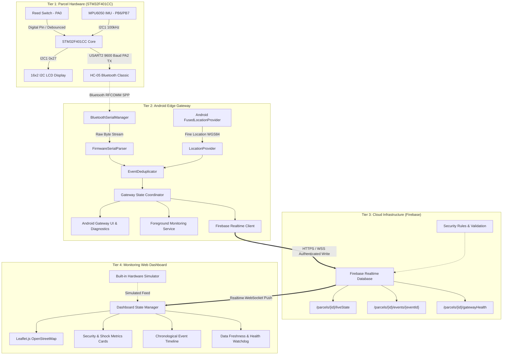
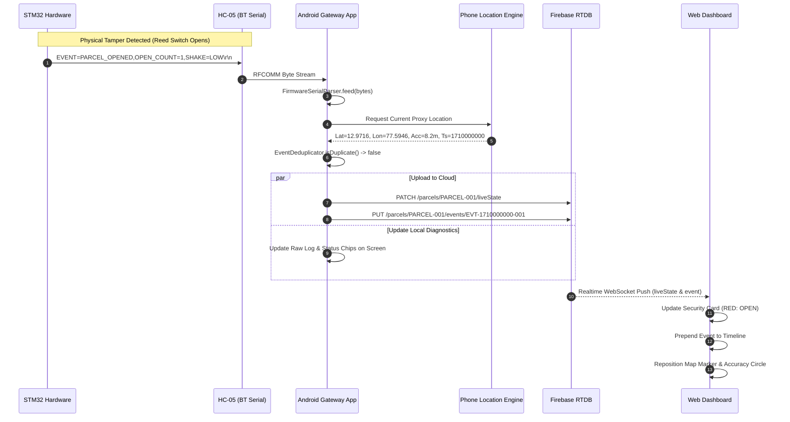

# Smart Parcel Condition Monitoring System
## End-to-End System Architecture Specification

### 1. System Overview
The Smart Parcel Condition Monitoring System provides real-time in-transit tracking of package integrity, physical tampering, motion shock, and geographic location. 

The architecture consists of four distinct tiers:
1. **Physical Sensing Tier**: STM32F401CC "Black Pill" microcontroller interfacing with an MPU6050 6-axis IMU, a reed magnetic tamper switch, a 16x2 I2C LCD, and an HC-05 Bluetooth Classic module.
2. **Edge Gateway Tier**: An Android mobile application operating as a secure communication bridge and proxy sensor node (supplying GPS coordinates and cellular/Wi-Fi uplink).
3. **Cloud & Database Tier**: Firebase Realtime Database with strict role-based security rules, decoupling real-time operational state from historical audit logs.
4. **Presentation Tier**: A responsive, mobile-first web dashboard using Leaflet.js, OpenStreetMap, and Firebase Client SDK with live telemetry, event timelines, stale-state detection, and an integrated hardware simulator.

---

### 2. Architecture & Data Flow Diagram

---

### 3. Subsystem Breakdown

#### 3.1 STM32 Firmware Interface (Confirmed Protocol)
- **Baud Rate**: 9600 bps, 8 data bits, no parity, 1 stop bit (8N1).
- **Communication Protocol**: Comma-delimited key-value ASCII strings terminated by CRLF (`\r\n`).
- **Confirmed Message Types**:
  1. `EVENT=STARTUP,STATUS=INITIALIZING\r\n`
  2. `EVENT=STARTUP,STATUS=READY\r\n`
  3. `STATUS=READY,REED=CLOSED,OPEN_COUNT=0,SHAKE=LOW,MPU=OK\r\n`
  4. `EVENT=PARCEL_OPENED,OPEN_COUNT=<n>,SHAKE=<level>\r\n`
  5. `EVENT=PARCEL_CLOSED,OPEN_COUNT=<n>,SHAKE=<level>\r\n`
  6. `EVENT=SHAKE_LEVEL_CHANGED,SHAKE=<level>,OPEN_COUNT=<n>\r\n`
  7. `STATUS=<SECURE|OPENED>,REED=<OPEN|CLOSED>,OPEN_COUNT=<n>,SHAKE=<level>,AX=<x>,AY=<y>,AZ=<z>,MPU=<OK|ERROR>\r\n`
  8. `ERROR=MPU6050_INIT_FAILED\r\n`
  9. `ERROR=MPU6050_READ_FAILED\r\n`
  10. `STATUS=MPU6050_RECOVERED\r\n`

#### 3.2 Android Gateway Architecture
- **Language**: Kotlin, Modern Android Architecture (MVVM + Coroutines + StateFlow).
- **Centralized Single-Owner Engine (`GatewayEngine`)**: Application-scoped singleton coordinator that owns `BluetoothSerialManager`, `LocationProvider`, `FirebaseGatewayService`, and `EventDeduplicator`. Decoupled completely from `MainActivity` lifecycle so that activity destruction, screen rotation, or navigating away does not terminate Bluetooth or GPS tracking.
- **Bluetooth Stack**: Native Android `BluetoothAdapter` and `BluetoothSocket` over standard Serial Port Profile (SPP UUID: `00001101-0000-1000-8000-00805F9B34FB`) with exponential backoff auto-reconnect (1s to 16s).
- **Resilient Serial Buffer**: Ring buffer / line accumulator that parses lines only upon receiving `\n`, gracefully discarding noise and recovering from fragmented TCP/RFCOMM packets. Handles boot status lines without AX, preserves null open counts, and validates shake levels against `{"LOW", "MEDIUM", "INTENSE"}`.
- **Location Services**: Google Play Services `FusedLocationProviderClient` operating with high-accuracy updates when moving, with clear user toggles and explicit permission rationales.
- **Background Execution**: Android Foreground Service with ongoing notification (`ParcelMonitoringForegroundService`) binding to `GatewayEngine` to ensure OS does not kill Bluetooth or network operations during screen-off states. Declares `connectedDevice` and `location` service types.
- **Deduplication Engine**: Hash-based windowed deduplicator caching recent event signatures to suppress duplicate uploads during retry storms or rapid sensor bounces.

#### 3.3 Cloud Backend (Firebase Realtime Database)
- **Zero Credentials in Source**: Database URL provided via configuration file; authentication uses Firebase Anonymous Authentication or Custom Tokens / Gateway Service Accounts.
- **Data Segregation**:
  - `/parcels/{parcelId}/liveState`: High-frequency overwrite node for current state (reduces bandwidth and client memory).
  - `/parcels/{parcelId}/events/{eventId}`: Append-only ledger for discrete security, shock, and status transition events.
  - `/parcels/{parcelId}/gatewayHealth`: Gateway heartbeat, battery/network diagnostics, Bluetooth connection status.
- **Strict Security Rules**: Enforce authenticated access (`auth != null`), gateway ownership scoping (`auth.uid === data.child('gatewayUid').val()`), schema types, string lengths, coordinate bounds (-90 <= lat <= 90, -180 <= lon <= 180), and public demo read exceptions (`isPublicDemo === true`).

#### 3.4 Web Dashboard Architecture
- **Tech Stack**: Vanilla HTML5, modern CSS3 (custom CSS custom properties, dark-mode glassmorphic design, flexible responsive CSS Grid and Flexbox), ES6+ Vanilla JavaScript.
- **Mapping**: Leaflet.js with OpenStreetMap raster tiles, dynamic accuracy radius circles, custom SVG parcel and status markers, and stale-location visual indicators. Prominently displays the "Proxy: Android Phone GPS" attribution badge.
- **XSS Protection**: All incoming Firebase strings (`eventType`, `description`, timestamps) are sanitized using `escapeHtml()` prior to DOM insertion.
- **Data Freshness Engine**: Real-time ticker comparing local browser wall-clock time with sensor timestamps, displaying 4-tier live freshness chips: `LIVE (<5s)`, `RECENT (5–30s)`, `DELAYED (30–60s)`, `STALE (>60s)`, or `NO DATA`.
- **Hardware Simulator**: Client-side interactive simulator capable of driving the dashboard with realistic STM32 telemetry and GPS drift for demonstration, offline testing, and validation.

---

### 4. Component Interaction Sequence

