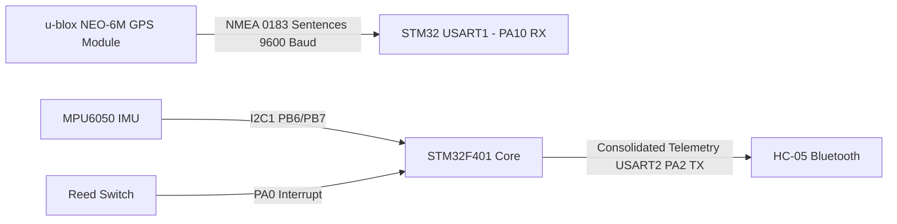

# Known Limitations & Future Hardware GPS Roadmap
## Smart Parcel Condition Monitoring System

### 1. Known Architectural Limitations (Version 1.0)

| Limitation | Technical Context | Mitigations Implemented in v1.0 |
| :--- | :--- | :--- |
| **Phone-Proxy Location** | The physical parcel does not contain an onboard GPS satellite receiver; coordinates reflect the courier's Android smartphone. | Explicit `locationSource: "PHONE_PROXY"` tag in data model, warning banner on Leaflet map, and dedicated switch allowing user to disable GPS reporting. |
| **Bluetooth Range Boundary** | HC-05 operates under Bluetooth Classic Class 2 ($\approx 10\text{m}$ line of sight). If courier steps away, connection breaks. | Auto-reconnect engine with exponential backoff and persistent foreground service to immediately resume data flow when phone re-enters range. |
| **Real-Time Clock Absence** | STM32F401 Black Pill does not have a battery-backed 32.768 kHz RTC crystal populated, relying solely on millisecond ticks (`g_ms_ticks`). | Hybrid timestamping model: monotonic device millis for interval checks, Unix epoch timestamps assigned by Android gateway and Firebase server (`.sv: "timestamp"`). |
| **I2C Bus Contention** | LCD backpack (`0x27`) and MPU6050 (`0x68`) share I2C1. High traffic can cause bus clock stretching or deadlocks. | Optimized polling intervals (100ms main loop, 250ms LCD refresh, 1000ms Bluetooth status report) and software bus reset sequence (`I2C1_ResetBus()`) on read timeout. |

---

### 2. Roadmap: Adding an Onboard GPS Module (NEO-6M / NEO-8M)

To eliminate dependency on the phone for location tracking, the system architecture has been intentionally designed to accommodate an onboard GPS module in Version 2.0.

#### 2.1 Hardware Interconnect Blueprint
The STM32F401CC has multiple hardware USART peripherals:
- **USART2 (PA2/PA3)**: Dedicated to HC-05 (or future Cellular module) at 9600 baud.
- **USART1 (PA9=TX, PA10=RX)**: Dedicated to u-blox NEO-6M / NEO-8M GPS receiver at 9600 baud.



#### 2.2 Firmware NMEA Parser Integration
The STM32 firmware can process `$GPRMC` or `$GNGGA` sentences using an interrupt-driven ring buffer on USART1:
```c
/* Future firmware extension in smart_parcel_monitor.c */
typedef struct {
    float latitude;
    float longitude;
    uint8_t fix_valid;
    uint32_t fix_time_utc;
} GpsData_t;

/* Emitted telemetry string in Version 2.0 */
(void)snprintf(bt_line, sizeof(bt_line),
               "STATUS=%s,REED=%s,OPEN_COUNT=%lu,SHAKE=%s,LAT=%.5f,LON=%.5f,GPS=FIX,MPU=%s\r\n",
               status_str, reed_str, g_open_count, shake_str,
               gps.latitude, gps.longitude, g_mpu_ok ? "OK" : "ERROR");
```

#### 2.3 Edge Gateway & Web Dashboard Compatibility
The data model already supports hardware GPS via the `source` field:
```json
{
  "location": {
    "latitude": 12.971598,
    "longitude": 77.594562,
    "accuracy": 2.5,
    "source": "HARDWARE_GPS",
    "isSharingEnabled": true
  }
}
```
When `source === "HARDWARE_GPS"`, the web dashboard automatically hides the proxy warning and displays a green **"Direct Onboard GPS Fix"** indicator.

---

### 3. Commercial IoT Production Considerations

For commercial mass-market logistics deployment:
1. **Direct Cellular Uplink (NB-IoT / LTE-M)**:
   - Replace HC-05 with a Quectel BG95 or SIM7000G module to communicate directly with Firebase or MQTT brokers via cellular networks, eliminating the smartphone gateway entirely.
2. **Power Budget & Battery Life**:
   - STM32F401 Stop Mode draws only $12\mu\text{A}$.
   - The MCU can stay in deep sleep and wake via external interrupt on PA0 (Reed switch tamper) or MPU6050 Motion Interrupt on INT pin (PA1).
   - This extends battery life on a single 2500 mAh LiPo battery from 18 hours to over **60 days**.
